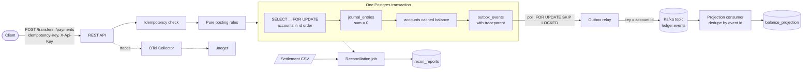
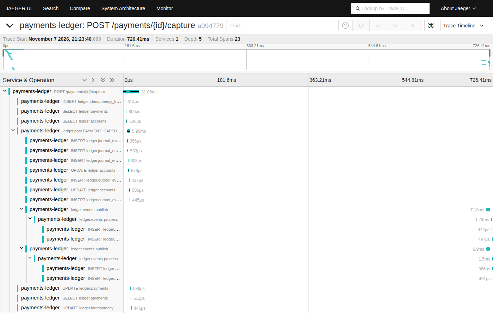

# payments-ledger-service

A double-entry ledger service for a marketplace that holds customer funds and pays out sellers.
Clients create accounts, authorize payments (holds), capture, void, refund, and transfer money.
Every money movement writes balanced journal entries and an outbox row in one Postgres transaction.
A relay publishes the outbox to Kafka. A consumer builds a balance read model.
A reconciliation job compares the ledger with a mock processor settlement file.

Stack: Java 25, Spring Boot 4.1.2, PostgreSQL 16, Flyway, Spring Kafka (Redpanda, Kafka API),
OpenTelemetry (Java agent, Collector, Jaeger), JUnit 5, jqwik, Testcontainers, k6.

Status: all checks below ran on one laptop. The GitHub Actions workflows exist but have not run yet.
See "Verified and not verified".

## Verified locally

All rows ran on one laptop. Numbers are measured on one laptop.

| Claim | Command | Evidence | Date |
|---|---|---|---|
| Three SLIs with burn-rate alerts, six alerts tested with promtool | `promtool test rules` (see `docs/engagement/evidence/promtool-slo-rules.txt`) | `docs/engagement/evidence/promtool-slo-rules.txt` | 2026-11-09 |
| Grafana SLO dashboard with live data after a k6 run | `podman-compose --profile obs up -d --build` | `docs/engagement/evidence/grafana-ledger-slo.png` | 2026-11-09 |
| Five failure scenarios, invariants pass after each | `lab/0*.sh` | `docs/engagement/evidence/lab-0*.txt` | 2026-11-09 |
| Dead-letter topic and once-only redrive | `./mvnw -B verify -Dit.test=DeadLetterIT` | `src/test/java/com/stanley/ledger/DeadLetterIT.java` | 2026-11-09 |
| Rollback by image digest across an expand and contract migration | `scripts/rollout.sh` | `docs/engagement/evidence/rollout-rollback-digest.txt` | 2026-11-09 |
| k6 SLO gate exits 99 on a forced slow run | `k6 run load/ledger.js` | `docs/engagement/evidence/k6-slo-gate.txt` | 2026-11-09 |
| Append-only caller audit log | `./mvnw -B verify -Dit.test=CallerAuditIT` | `src/test/java/com/stanley/ledger/CallerAuditIT.java` | 2026-11-09 |
| Compose files pass `podman compose config` and `docker compose config` | see the file | `docs/engagement/evidence/compose-config.txt` | 2026-11-09 |
| Security scans: gitleaks, semgrep, trivy (source and image) | see `docs/engagement/SECURITY-GATE.md` | `docs/engagement/evidence/security-gate-local.txt` | 2026-11-09 |

## Authored, not run

| File | What it would do | Why it did not run |
|---|---|---|
| `.github/workflows/ci.yml` (digest artifact, promtool job, SLO thresholds) | Run the new checks on GitHub | Authored, not run: this file is written and syntax-checked with `actionlint 1.7.12`. It was not executed against GitHub Actions. Reason: needs GitHub Actions. |
| `.github/workflows/security.yml` | Run the five security jobs | Authored, not run: this file is written and syntax-checked with `actionlint 1.7.12`. It was not executed against GitHub Actions. Reason: needs GitHub Actions. |
| Multi-broker Kafka behavior | Replication, broker loss and leader moves | Not run. The local stack has one Redpanda node. |
| Managed stream services (MSK, Kinesis) | The options in `docs/engagement/adr/0003-streaming-choice.md` | Not run. Decision level only, no cloud account by design. |

## Architecture



Trace of one capture request, from the HTTP call through JDBC and Kafka to the consumer:



## Run it

You need Java 25 (JDK), Maven, podman, podman-compose and k6.

```bash
# unit, property tests, Spotless check (no containers)
./mvnw -B verify -DskipITs

# integration tests (Postgres and Redpanda in containers, with rootless podman)
systemctl --user enable --now podman.socket
export DOCKER_HOST=unix:///run/user/$(id -u)/podman/podman.sock TESTCONTAINERS_RYUK_DISABLED=true
./mvnw -B verify

# local stack: app, Postgres, Redpanda, Collector, Jaeger (ports 18080, 18432, 18092, 18318, 18686)
./mvnw -B -DskipTests package
scripts/fetch-otel-agent.sh
mkdir -p .data/otel
podman-compose up -d --build
scripts/demo.sh            # one payment from start to finish
scripts/trace-check.sh     # one trace must hold HTTP, JDBC, Kafka producer and consumer spans
k6 run load/ledger.js      # 20 VUs, 2 minutes
scripts/invariants.sh      # SQL invariants after the run
```

Jaeger UI: http://127.0.0.1:18686. OpenAPI file: http://127.0.0.1:18080/openapi.yaml.
Metrics: `/actuator/prometheus`. The local API key is `dev-key-local-only`. See SECURITY.md.

More: [docs/ONBOARDING.md](docs/ONBOARDING.md), [docs/RUNBOOK.md](docs/RUNBOOK.md),
[docs/DEMO.md](docs/DEMO.md), [docs/PERF.md](docs/PERF.md), [docs/DECISIONS.md](docs/DECISIONS.md),
[SECURITY.md](SECURITY.md), [LEARN.md](LEARN.md).

## What is checked

| Check | Where | Result on the laptop |
|---|---|---|
| Every journal transaction sums to zero, no account below its floor, cache equals journal (property test, random sequences of authorize, capture, void, refund, transfer) | `LedgerPropertiesTest` | 1,000 sequences of 1 to 80 operations: pass |
| No `double`, `float` or `BigDecimal` in the `ledger` package | `NoFloatingPointTest` | pass |
| Same key and body replays the response and posts once. Same key with another body gives 422. Two parallel requests with one key post once | `ApiIT` | pass |
| 50 threads, 2,000 random transfers, 10 accounts: money unchanged, no negative balance, no deadlock | `ConcurrencyIT` | pass (about 1,550 posted, about 450 rejected by the floor) |
| Relay crash mid-batch: every event reaches Kafka at least once, projection counts each once | `KafkaFlowIT` | pass (105 events, 7 duplicates on the topic, 105 applied once) |
| Same event twice changes the projection once | `KafkaFlowIT` | pass |
| Projection equals ledger after a random workload | `KafkaFlowIT` | pass |
| Reconciliation: 98 matched, 1 missing, 1 mismatched | `ReconciliationIT` | pass |
| One trace holds HTTP server, JDBC, Kafka producer and Kafka consumer spans | `scripts/trace-check.sh` | pass on the local stack |
| Load: 20 VUs, 2 minutes, error rate below 0.1 percent, zero invariant violations | `load/ledger.js` | 282 requests/s, p95 145 ms, 0.00 percent errors, 0 violations (measured on one laptop) |
| OpenAPI file lists every route of the controller | `OpenApiSpecTest` | pass |

Test totals: 4 unit and property tests, 11 integration tests, 0 failures.
Full numbers and settings are in [docs/PERF.md](docs/PERF.md).

## Verified and not verified

Verified on this laptop (Fedora 44, rootless podman, Java 25.0.4): everything in the table above, and Spotless (google-java-format).

Not verified yet. These run only in GitHub Actions, which has not run for this repo:
- the `build`, `integration`, `trace-check` and `k6-smoke` jobs on `ubuntu-latest` with Docker;
- the `codeql` job (Java 25 support in CodeQL is not checked);
- the `openapi-lint` job (Spectral). Locally, only a YAML parse and a route-coverage test ran;
- Temurin 25 on the runner (local runs use the Red Hat build of OpenJDK 25).

A skill goes on a resume only when its local proof command and evidence file exist.

## What this is not

- Kafka is Redpanda, one node. No multi-broker cluster, no replication tuning, no Schema Registry. Payloads are JSON with a version field.
- No real payment processor and no card data. The processor is a CSV file. There is no PCI-DSS scope.
- One currency per account, no FX. A transfer between two currencies is rejected.
- Delivery is at least once with consumer dedupe. It is not Kafka exactly-once transactions.
- Auth is a static API key per client. It is a placeholder for OAuth2.
- Not deployed to any cloud.
- One Maven module with packages, not several modules.
- JDBC with explicit SQL through `JdbcClient`. It does not use Spring Data JDBC repositories.
- Holds do not expire. Idempotency keys do not expire. A malformed record stays on the dead-letter topic until a person reviews it.
- Reconciliation compares captured amounts. It does not net refunds.
- The Postgres in compose uses default durable settings. The numbers in PERF.md come from them.

## Layout

```
src/main/java/com/stanley/ledger
  ledger/      pure rules (Rules), state records, LedgerService (the transaction shell)
  idem/        idempotency executor
  outbox/      outbox writer, relay
  projection/  Kafka consumer and read model
  recon/       reconciliation service and job
  api/         controller, API key filter, error mapping
src/main/resources/db/migration   Flyway SQL
load/ledger.js  k6 script           scripts/   demo, trace and invariant checks
compose.yaml, Dockerfile, otel/     local stack
```

## License

MIT. Copyright (c) 2026 Stanley Sujith Nelavala.
