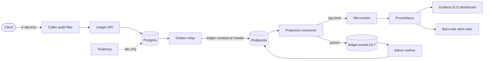

# Architecture

Fictional customer. This file shows the parts added for the reliability work. The base design is in the README.

Trust boundaries: the client crosses the API key check. The operator crosses the admin key check. Toxiproxy exists only in the lab profile.

| Component | Role |
|---|---|
| Caller audit filter | Writes one append-only row per call. Wraps the key filter. |
| Ledger API | Idempotent writes. Optional `externalRef` on payments. |
| Outbox relay | Publishes unsent rows. Adds the `ledger-created-at` header. |
| Projection consumer | Builds balances. Records `ledger.projection.lag`. Sends poison events to the DLT. |
| Admin redrive | Reads the DLT and publishes records again. Needs `X-Admin-Key`. |
| Prometheus rules | Recording rules and multi-window burn-rate alerts for three SLIs. |
| Grafana | Provisioned SLO dashboard. |
| Toxiproxy | Adds latency to Postgres in the failure lab. |
