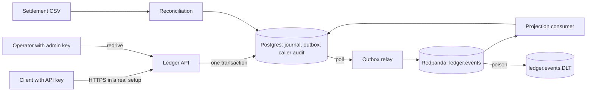

# Threat model: money path (short STRIDE)

Fictional customer. This review covers the money path of the ledger only. It is a short review, not a full assessment.

## Data flow

Trust boundaries: client to API, operator to admin route, settlement file to reconciliation, API to database.

## STRIDE table

| # | Threat | Type | Control | File | Test |
|---|---|---|---|---|---|
| 1 | A caller uses a stolen or guessed API key | Spoofing | Static key check. Unknown key gets 401. The risk is accepted for now (RISK-DECISION). | `ApiKeyFilter.java` | `CallerAuditIT.unauthorizedRequestsAreAuditedAsAnonymous` |
| 2 | A client retries a transfer and it posts twice | Tampering | Idempotency key with body hash. | `IdempotentExecutor.java` | `ApiIT.sameKeySameBodyReplaysTheResponseAndPostsOnce` |
| 3 | A caller reuses a key with a different amount | Tampering | The body hash differs, so the call gets 422. | `IdempotentExecutor.java` | `ApiIT.sameKeyDifferentBodyReturns422` |
| 4 | A caller denies a call | Repudiation | Append-only caller audit log with client name, route, key, outcome, trace id. | `CallerAuditFilter.java`, `V4__caller_audit.sql` | `CallerAuditIT.updateAndDeleteAreRejected` |
| 5 | A reader sees journal data without a key | Information disclosure | Every business route needs a key. Metrics and health carry no account data. | `ApiKeyFilter.java` | `ApiIT.writesNeedAnIdempotencyKeyAndAnApiKey` |
| 6 | A caller floods the outbox with writes | Denial of service | Not rate limited today. The unsent outbox count and the freshness SLO show the effect. | `slo.rules.yml` | `DeadLetterIT.poisonEventGoesToDltAndOthersApply` |
| 7 | A slow or stuck consumer lets the projection lag | Denial of service | Freshness SLI and burn-rate alerts. A poison event goes to the DLT and does not block. | `ProjectionConsumer.java` | `DeadLetterIT.poisonEventGoesToDltAndOthersApply` |
| 8 | An operator route replays records or is abused | Elevation of privilege | `X-Admin-Key` is separate from client keys. With no admin key set, the route answers 403. | `AdminController.java` | `CallerAuditIT.adminRedriveAnswers403WithoutAnAdminKey` |
| 9 | A tampered settlement CSV hides a mismatch | Tampering | The report lists missing, mismatched and unexpected rows. A person reviews it. | `ReconciliationService.java` | `ReconciliationIT.fixtureWithOneMissingOneMismatchedAndNinetyEightMatched` |
| 10 | Float rounding changes an amount | Tampering | Amounts are integer minor units. A test bans floating point in the ledger package. | `ledger/` | `NoFloatingPointTest.ledgerPackageHasNoFloatingPoint` |
| 11 | A relay crash duplicates an event | Tampering | At-least-once delivery. `processed_events` removes repeats. | `ProjectionConsumer.java` | `KafkaFlowIT.relayCrashMidBatchStillDeliversEveryEventAndProjectionCountsOnce` |

## Known gaps

Static keys, no rate limit, no transport security in the local stack, and a trigger-only append-only control (a superuser can still truncate). See `SECURITY.md`.
